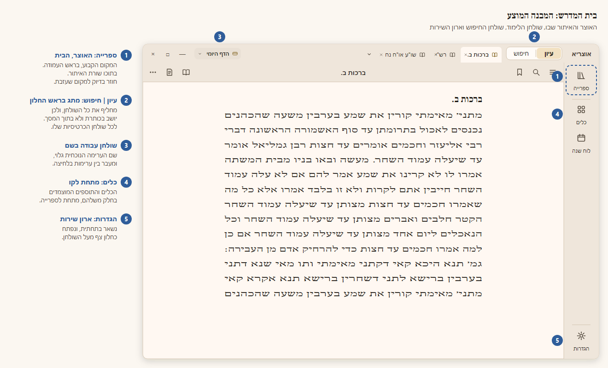
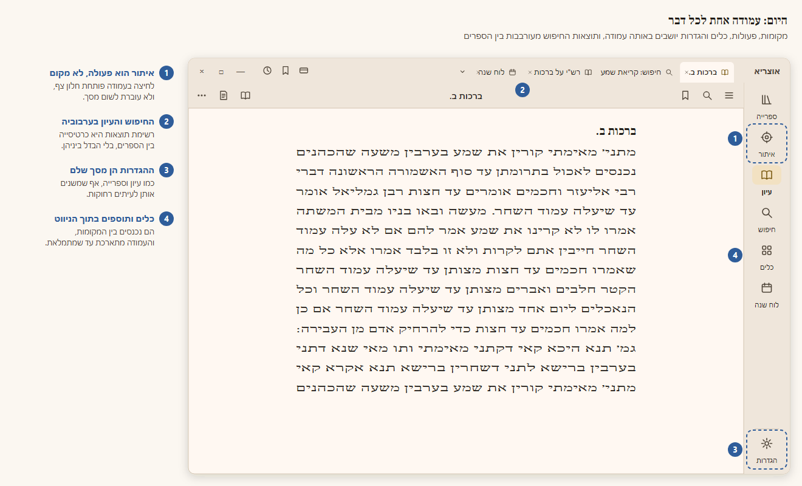
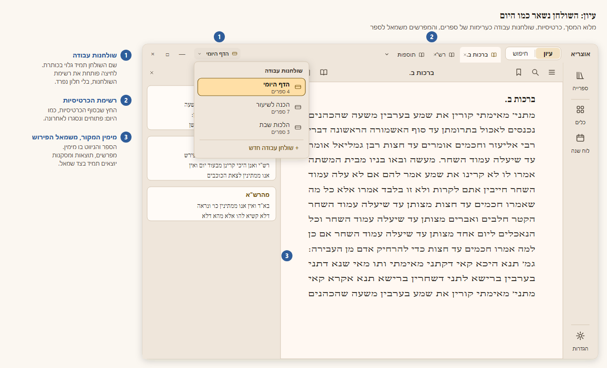
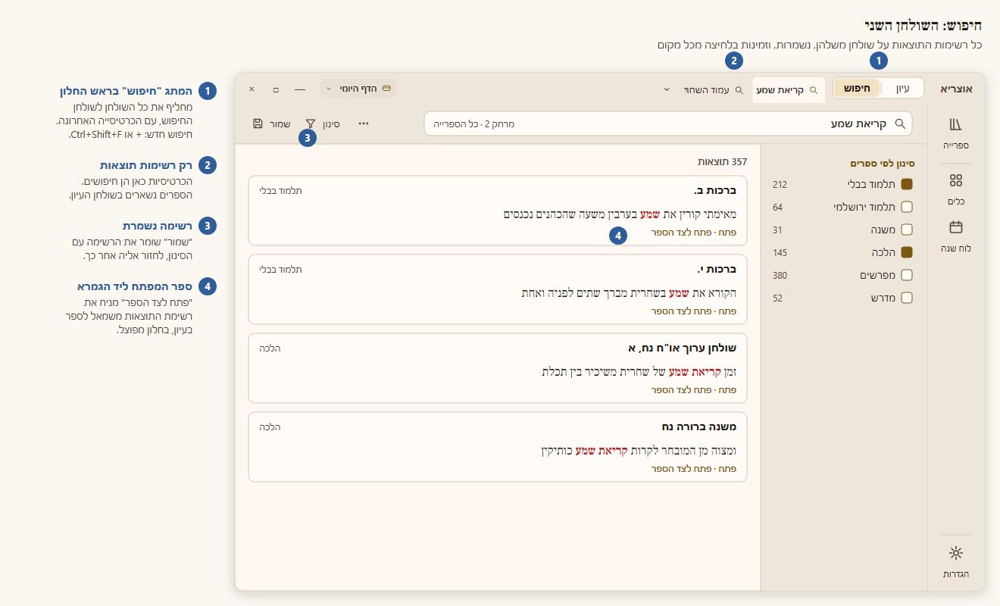

# מבנה התוכנה: בית המדרש

> **מעמד:** הצעה לדיון, ממתינה להכרעת בעל הפרויקט והמפתחים הראשיים. אחרי אישור יסומנו הכללים **[מחייב]**, כמו בשאר התקן.
> **מקור:** הדיון בפורום על מבנה התוכנה, [פוסט 50303](https://otzaria.org/forum/post/50303) וההודעה שלפניו.
> **יחס למסמכים אחרים:** [DESIGN_SYSTEM.md](DESIGN_SYSTEM.md) קובע איך כל רכיב נראה. המסמך הזה קובע **איפה כל חלק של התוכנה יושב ובאיזו צורה ניגשים אליו**. בכל מקום שהם נוגעים זה בזה, הטוקנים והרכיבים לקוחים מהתקן.
> **ההדמיות:** בערכת ברירת המחדל ("חום זהבהב", בהיר), ברוחב מחשב. הן להמחשה, ואינן קובעות ערכים.

## 1. למה צריך מסמך יסוד

היום כל החלקים של התוכנה יושבים בעמודה אחת ובאותה צורה: ספרייה, איתור, עיון, חיפוש, כלים, תוספים מוצמדים והגדרות. אבל הם לא דומים זה לזה:

- חלק מהם הם **מקום** שנכנסים אליו ושוהים בו (ספרייה, עיון).
- חלק הם **פעולה** קצרה (איתור), או פעולה ארוכה שהתוצאה שלה נשמרת (חיפוש).
- חלק הם **שירות** שפונים אליו לעיתים רחוקות (הגדרות).

כשהכול נראה אותו דבר, המשתמש לא יודע למה לצפות מכל כפתור, והמפתחים לא יודעים איפה להוסיף דבר חדש. המסמך הזה נותן לכל חלק בית אחד וצורה אחת. ההכרעה נגזרת משתי שאלות:

1. **בתור מה ניגשים אליו?** מקום, שולחן, פעולה או שירות.
2. **מה מקבלים בו?** ספר פתוח, רשימת תוצאות, מעבר למקום ידוע, או שינוי של התוכנה עצמה.

## 2. המשל: בית המדרש

התוכנה היא חדר לימוד ("אוצֶר") שנכנסים אליו לעסוק בתורה.

| בתוכנה | בבית המדרש | בתור מה ניגשים | מה מקבלים | הצורה בממשק |
|---|---|---|---|---|
| **ספרייה** | האוצר עצמו: הבית וארון הספרים, מסודר וממוין | המקום הקבוע | ספר לפתוח, או מקום ידוע | כפתור קבוע בראש העמודה. מסך מלא שזוכר את מצבו, ובו המדפים, חיפוש השמות ושורת האיתור. בשעת הצורך נפתח כחלונית צד |
| **עיון** | השולחן או הסטנדר, ועליו הספרים הפתוחים | שולחן | ספרים פתוחים, כל אחד במקומו | מלוא המסך, כרטיסיות, שולחנות עבודה |
| **חיפוש** | סטנדר נוסף ליד השולחן, ועליו ספר מפתחות | שולחן שני | רשימות תוצאות שנשמרות | שולחן משלו, ומתג בראש החלון שעובר בין שני השולחנות |
| **איתור** | פתיחת סימנייה בספר מן הארון | פעולה קצרה, בתוך עולם הספרייה | מעבר למקום ידוע | שורה בראש האוצר, ושורה כזו גם בחלונית שלו. ממנה נגללות האפשרויות |
| **כלים** | כלי עזר שמניחים על השולחן | פעולה שפותחת כלי | כלי בכרטיסייה בשולחן | בעמודה, מתחת לקו, בחלק משלהם |
| **הגדרות** | ארון שירות: השעון, לוח החשמל, המונה | שירות | שינוי התוכנה עצמה | חלון צף מעל השולחן, מכפתור בתחתית העמודה |

## 3. כללי יסוד

**כלל 1. הצורה נקבעת לפי סוג הגישה, לא לפי מי כתב את הקוד.**

| סוג | הצורה | דוגמה |
|---|---|---|
| מקום | כפתור בעמודה הימנית, מסך מלא שזוכר את מצבו | ספרייה |
| שולחן | מתג בראש החלון, וכרטיסיות שייכות לשולחן | עיון, חיפוש |
| פעולה | שורה בתוך המקום שהפעולה שייכת לו, או חלון צף. נסגרים אחרי שהפעולה נעשתה | איתור, בתוך הספרייה |
| שירות | חלון צף מכפתור בתחתית העמודה | הגדרות |

**כלל 2. מימין המקור, משמאל מה שיוצא ממנו.**
התוכנה עברית, מימין לשמאל. כל מה שהוא מקור ונקודת מוצא יושב ונפתח מימין: הספרייה וארון הספרים, האיתור, עץ הניווט בספר ועץ הסינון בחיפוש. כל מה שיוצא מן המקור, כמו מפרשים, תוצאות ומסקנות, יוצא בצד שמאל. כך העין קוראת מימין לשמאל, מן המקור אל מה שנובע ממנו.

**כלל 3. מתג שמחליף את כל השולחן יושב בראש החלון.**
המעבר בין עיון לחיפוש מחליף את כל שטח העבודה, את הכרטיסיות ואת התוכן. לכן הוא בשורת הכותרת, מעל הכול, ולא בתוך המסך ולא בעמודה.

**כלל 4. העמודה מחזיקה רק את מה שמחוץ לשולחן.**
למעלה הספרייה. מתחת לקו הכלים והתוספים המוצמדים. בתחתית ההגדרות. איתור אינו מקום בפני עצמו, אלא חלק מהאוצר, ולכן אינו בעמודה ואינו בשורת הכותרת. גם עיון וחיפוש אינם בעמודה, כי הם השולחן עצמו, והמתג שלהם בראש החלון.

**כלל 7. פעולה יושבת בתוך העולם שלה.**
פעולה לא מקבלת כפתור משלה בעמודה או בכותרת. היא יושבת במקום שממנו היא נובעת: האיתור בתוך האוצר, חיפוש חדש בשולחן החיפוש, וניהול שולחנות העבודה ליד שם השולחן.

**כלל 5. הקריאה במרכז.**
כל שינוי במבנה נבחן לפי השאלה אם הוא מפריע ללימוד. אזור הקריאה נשאר שקט, כמו שקובע DESIGN_SYSTEM §1.1 סעיף 3. חלון צף לא מחליף את השולחן, אלא נפתח מעליו, והלימוד נשאר מאחוריו במקומו.

**כלל 6. מקום חוזר בדיוק למצב שבו הניחו אותו.**
ספרייה, שולחן העיון ושולחן החיפוש זוכרים את הכרטיסייה, את הגלילה, את הסינון ואת הבחירה. היציאה מהם והחזרה אליהם לא מאבדות דבר.

## 4. המצב היום

לפי הקוד בענף `dev`:

- **העמודה** (`_navData`, `main_window_screen.dart`) מציגה את הפריטים האלה, לפי הסדר: ספרייה, איתור, עיון, חיפוש, כלים. אחריהם באים הכלים והתוספים המוצמדים, ובתחתית ההגדרות.
- **ספרייה:** מסך מלא, שנשמר כ־`KeepAlivePage` ולכן זוכר את מצבו. אין לה תצוגה כחלונית לצד העיון.
- **איתור:** לחיצה בעמודה פותחת את `FindRefDialog`, חלון צף.
- **עיון וחיפוש:** חולקים מסך אחד ורשימת כרטיסיות אחת. החיפוש פותח את `SearchDialog`, ותוצאה נוספת ככרטיסייה בין הספרים. `NavigationBloc` גוזר "עיון" או "חיפוש" מסוג הכרטיסייה הפעילה.
- **כלים:** `ToolsLauncherPanel` צף מימין. כלי שנבחר נפתח ככרטיסייה בעיון.
- **הגדרות:** מסך מלא, עמוד שלישי ב־`PageView` הראשי, כמו ספרייה ועיון.
- **סימניות, היסטוריה ושולחנות עבודה:** כפתורים בשורת הכותרת, ומכל אחד נפתח חלון צף.

## 5. ההצעות

### 5.1 ספרייה: האוצר, הבית

הספרייה היא הבית עצמו, לא רק מסך פתיחה. זה האוצר שנכנסים אליו, והמקום הקבוע של התוכנה. כל מה שנוגע למציאת ספר או מקום שייך לעולם שלו.

**מוצע:**
- כפתור הספרייה נשאר קבוע בראש העמודה, וקו מפריד אותו מהכלים שמתחתיו.
- החזרה לספרייה מחזירה בדיוק למצב שבו הנחת אותה. זה כבר קיים היום, ונשמר.
- **מסך האוצר נשאר כמו היום:** תיבות המדפים, שדה החיפוש בשמות של מדפים וספרים, הדף היומי והתצוגה המקדימה. התצוגה המקדימה בצד שמאל (כלל 2).
- **בראש האוצר יש שורת איתור** לכתיבת מראה מקום ולמעבר מיידי. היא בולטת יותר משדה חיפוש השמות, כי היא עושה פעולה אחרת (§5.3).
- **שדה חיפוש השמות:** התווית של היום, "איתור ספר או מחבר ב…", מתחלפת ל"חיפוש מדף או ספר ב…". כך לא תהיה התנגשות עם "איתור" של מראה מקום.

**לא משתנה:** תיבות המדפים, תצוגת הרשת והרשימה, התצוגה המקדימה, הדף היומי והקיצור Ctrl+L.

**ארון הספרים כחלונית:** בתוך העיון אפשר לפתוח את האוצר כחלונית צד ימנית, ברשימה. זה כמו להרים את הראש מעל הסטנדר, ולהסתכל מה עוד אפשר להוציא מהארון.
- בראש החלונית יש אותה שורת איתור, ומתחתיה סינון מדפים וספרים.
- ספר שנבחר נפתח בכרטיסייה חדשה בשולחן הנוכחי, והחלונית נשארת פתוחה.
- בתחתית החלונית יש קישור "לאוצר המלא", שעובר למסך הספרייה באותו מקום.

### 5.2 עיון: השולחן

**מוצע:**
- השולחן נשאר כמו היום: מלוא המסך, כרטיסיות, ורשימה נפתחת של הפתוחים ושל אלה שנסגרו לאחרונה.
- **שולחנות עבודה גלויים:** שם השולחן הנוכחי מופיע בשורת הכותרת. לחיצה עליו פותחת רשימה נפתחת של השולחנות, כמו ערימות של ספרים, במקום חלון נפרד. מנהלים את השולחנות מתוך אותה רשימה.
- המפרשים יוצאים משמאל לספר (כלל 2).

**לא משתנה:** אזור הקריאה, סרגל הקורא, החלון המפוצל ומיקום הכרטיסיות (למעלה או בצד).

### 5.3 איתור: סימנייה ביד, בתוך האוצר

האיתור הוא בקשה לגשת ישירות למראה מקום ידוע. זו פעולה פשוטה וחד־פעמית, כמו לפתוח סימנייה בספר שמוציאים מן הארון. לכן מקומו בתוך עולם הספרייה, ולא בשורת הכותרת ליד שם התוכנה (כלל 7).

**מוצע:**
- האיתור יוצא מהעמודה. במקומו יש **שורת איתור** בראש מסך האוצר, ושורה כזו גם בראש החלונית "ארון הספרים".
- Ctrl+O, כמו היום, מביא אליה מכל מקום. מהספרייה הוא ממקד את השורה. מהשולחן הוא פותח את ארון הספרים כחלונית, עם השורה בראשה, בלי לעזוב את הלימוד.
- מקלידים מראה מקום, ותוך כדי כך נגללת רשימה ובה שלושה מקטעים: **מראי מקום**, **סימניות** ו**נפתחו לאחרונה**. כולם גישה ישירה למקום ידוע, ולכן כולם במקום אחד.
- Enter פותח את התוצאה הראשונה בשולחן הנוכחי.
- בתחתית הרשימה יש שני מעברים. "חפש בכל הספרים" עובר לשולחן החיפוש. "איתור מתקדם…" פותח את החלון של היום, עם כל המסננים שלו.

### 5.4 חיפוש: השולחן השני

החיפוש הוא פעולה ארוכה, שצריכה יישוב דעת בפני עצמו:

1. צריך להגדיר את תנאי החיפוש: איפה מחפשים, ואילו מילים בדיוק.
2. פעמים רבות חוזרים ומדייקים את השאילתה.
3. התוצאה שלו היא לא מקום אחד, אלא **רשימה** שרוצים לראות מול העיניים, להתבונן בה ולחקור אותה.
4. מכל אלה, רוצים גם שהרשימה תישמר להמשך.

לכן החיפוש דומה לסטנדר נוסף ליד השולחן.

**מוצע:**
- **מתג "עיון | חיפוש" בראש החלון**, בשורת הכותרת, מימין, ליד שם התוכנה. הוא מחליף את כל השולחן: את הכרטיסיות ואת התוכן (כלל 3).
- לכל שולחן יש רשימת כרטיסיות משלו. כרטיסיות החיפוש יושבות רק בשולחן החיפוש, והספרים נשארים בשולחן העיון. כל שולחן זוכר את הכרטיסייה האחרונה שהייתה פתוחה בו.
- חיפוש חדש נפתח בכפתור "+" בשולחן החיפוש, או ב־Ctrl+Shift+F, כמו היום.
- **שמירת רשימה:** הרשימה נשמרת עם השאילתה והסינון, כדי לחזור אליה אחר כך.
- **ספר המפתחות ליד הגמרא:** "פתח לצד הספר" מניח את רשימת התוצאות משמאל לספר, בחלון מפוצל בשולחן העיון. אפשר לעשות זאת היום בגרירה, וההצעה רק מקצרת את הדרך.
- בתוך שולחן החיפוש, עץ הסינון לפי ספרים יושב מימין והתוצאות משמאל (כלל 2).

### 5.5 כלים ותוספים

**מוצע:**
- "כלים" נשאר בעמודה, מתחת לקו שמפריד אותו מהספרייה. הכלים והתוספים המוצמדים יושבים אחריו, בחלק משלהם.
- כלי נפתח ככרטיסייה בשולחן העיון, כמו היום. כלי עזר מונח על השולחן, ליד הספרים.
- כשהעמודה מתמלאת בכלים מוצמדים, הם נכנסים לגלילה בתוך החלק שלהם. הם לא דוחפים את ההגדרות ולא מזיזים אותן ממקומן.

### 5.6 הגדרות: ארון השירות

ההגדרות הן עניין טכני ושולי, שמחוץ לשטח העבודה. גם היום הסמל שלהן מופרד מהשאר ועומד בתחתית. אבל הן נפתחות כמסך מלא, כמו מקום שבאים לשהות בו.

**מוצע:**
- **חלון צף**, `AppDialogFrame(size: large)`, שנפתח מעל השולחן. מתחת לרוחב 600 הוא נפתח במסך מלא, לפי DD-16. Esc סוגר אותו, והלימוד נשאר מאחוריו במקומו.
- בתוך החלון יש עמודת ניווט מימין, וחיפוש בהגדרות כמו היום.
- המבנה הפנימי לפי ההצעה למבנה ההגדרות: שמונה לשוניות בשלוש קבוצות.
  - **תצוגה וקריאה:** מראה, כתב, עיון בספר.
  - **ספרייה וכלים:** ספרייה, חיפוש, כלים.
  - **התוכנה:** קיצורי מקשים, מערכת.
- **אודות ותודות** יוצאים מרשימת הלשוניות לקישור בתחתית החלון, כי תודות אינן הגדרה.

### 5.7 מסכים צרים

- **בטלפון:** סרגל תחתון ובו ספרייה, עיון, חיפוש וכלים. בסרגל התחתון אין שורת כותרת שאפשר לשים בה את המתג, ולכן עיון וחיפוש חוזרים להיות יעדים בו. ההגדרות נמצאות בתפריט "עוד".
- **שורת האיתור:** בראש מסך הספרייה, כמו במחשב.
- **הגדרות:** חלון במסך מלא (DD-16).
- **ארון הספרים:** בטלפון אין חלונית צד. הוא נפתח כגיליון שעולה מלמטה, ושורת האיתור בראשו.

## 6. תכנית מימוש

כל שלב הוא PR אחד, ממוקד, ועם תמונות לפני ואחרי, כפי ש־DESIGN_SYSTEM §0 דורש לכל שינוי מראה. לפי DD-30 B, פירוק של קובץ גדול נעשה כ־commit נפרד שמשמר את ההתנהגות, לפני ה־commit שמשנה את המראה. כל שלב עומד בפני עצמו: אפשר לעצור אחרי כל אחד מהם, והתוכנה נשארת שלמה.

| שלב | מה | קבצים עיקריים | סיכון | תלוי ב |
|---|---|---|---|---|
| 0 | המסמך הזה וההדמיות | `docs/design-system/` | אין | — |
| 1 | **הגדרות כחלון צף.** `SettingsScreen` נפתח ב־`showDialogUntilTornDown` בתוך `AppDialogFrame(size: large)`. העמוד השלישי יוצא מה־`PageView` הראשי. `Screen.settings` נשאר כמצב "החלון פתוח", כמו `find` היום | `main_window_screen.dart`, `settings_screen.dart`, `navigation_bloc.dart` | בינוני: קישורים עמוקים להגדרות, יעדי הסיור המודרך (`TourTargetKeys.settingsTabs`), `SettingsScreenController.openTab` | 0 |
| 2 | **סידור ההגדרות מבפנים**, לפי ההצעה למבנה ההגדרות. כרטיסים עוברים בין לשוניות, ו"אודות" יוצא לקישור | `lib/settings/tabs/*`, `settings_screen.dart`, אינדקס החיפוש | נמוך: העברת כרטיסים, `searchEntries` מתעדכנים | 1 |
| 3 | **שני שולחנות.** מתג "עיון \| חיפוש" בשורת הכותרת. הכרטיסיות מסוננות לפי השולחן, וכל שולחן זוכר את הכרטיסייה הפעילה שלו. עיון וחיפוש יוצאים מהעמודה, וכפתור "+" לחיפוש חדש | `custom_title_bar.dart`, `reading_screen.dart`, `navigation_bloc.dart`, ה־bloc של הכרטיסיות, `tab_search_menu.dart` | גבוה: שמירת כרטיסיות ושולחנות עבודה, חלון מפוצל שמשלב ספר ותוצאה (שייך לעיון), קיצורי מעבר בין כרטיסיות | 0 |
| 4 | **שורת האיתור בראש האוצר**, עם מקטעים למראי מקום, לסימניות ולאחרונים. `FindRefDialog` נשאר כ"איתור מתקדם". איתור יוצא מהעמודה, וכפתורי הסימניות וההיסטוריה יוצאים מהכותרת. Ctrl+O מביא לשורה. התווית של שדה השמות מתחלפת ל"חיפוש מדף או ספר" | `library_browser.dart` (פירוק לפני כן), `lib/find_ref/`, `lib/bookmarks/`, `lib/history/`, `custom_title_bar.dart` | בינוני: פוקוס ומקלדת, ושתי שורות קלט סמוכות במסך הספרייה | 0 |
| 5 | **ארון הספרים כחלונית ימנית** בעיון, עם שורת האיתור בראשה. תצוגת רשימה של הספרייה בתוך `AdaptiveSidePane` בצד ההתחלה. Ctrl+O מהשולחן פותח אותה | `library_browser.dart`, `reading_screen.dart` | בינוני: `library_browser.dart` גדול, ומופיע ב־§4.3 בין הקבצים שמחכים לפירוק | 4 |
| 6 | **שם שולחן העבודה בכותרת**, עם רשימה נפתחת. `WorkspaceSwitcherDialog` נשאר לניהול מלא | `custom_title_bar.dart`, `lib/workspaces/view/` | נמוך | 3 |
| 7 | **מסכים צרים:** הסרגל התחתון, שורת האיתור והגיליון של ארון הספרים | `main_window_screen.dart`, `bottom_nav_labels.dart` | בינוני | 3, 4, 5 |

**סדר מומלץ:** 0, 1, 2, ואז 4 ו־5 (האוצר והאיתור שבו), ואז 3 ו־6 (השולחנות), ובסוף 7. שלבים 1 ו־2 נותנים שיפור גלוי כבר בהתחלה, בסיכון נמוך.

## 7. שאלות להכרעה

1. **האם עיון וחיפוש יוצאים מהעמודה?** המלצה: כן, כי המתג בראש החלון כבר עושה את עבודתם. כפילות תבלבל. בטלפון הם נשארים בסרגל התחתון (§5.7).
2. **שולחנות עבודה ושולחן החיפוש:** האם שולחן עבודה שומר גם את רשימות החיפוש שלו? המלצה: כן. שולחן עבודה הוא "סוגיה", והחיפושים שלה שייכים לה.
3. **סימניות והיסטוריה:** האם הכפתורים יוצאים מהכותרת, לטובת הרשימה של שורת האיתור באוצר? המלצה: כן. הניהול המלא נשאר בחלונות הקיימים, ופותחים אותם מתוך הרשימה.
4. **איך פותחים את ארון הספרים כחלונית?** אפשר בלחיצה שנייה על "ספרייה" כשכבר נמצאים בעיון, או בכפתור בסרגל הקורא. המלצה: שתי הדרכים.
5. **Ctrl+O מתוך השולחן:** האם הוא פותח את ארון הספרים כחלונית ליד הלימוד, או עובר למסך האוצר? המלצה: חלונית, כדי שהלימוד יישאר מול העיניים.
6. **מיקום הכרטיסיות "בצד":** בעמודת הכרטיסיות הצדדית, המתג בין השולחנות נשאר בכותרת. ראש עמודת הכרטיסיות מראה את שם השולחן ואת מספר הכרטיסיות שבו.
