# מבנה התוכנה: בית המדרש

> **מעמד:** הצעה לדיון, ממתינה להכרעת בעל הפרויקט והמפתחים הראשיים. אחרי אישור יסומנו הכללים **[מחייב]**, כמו בשאר התקן.
> **מקור:** הדיון בפורום על מבנה התוכנה, [פוסט 50303](https://otzaria.org/forum/post/50303) וההודעה שלפניו.
> **יחס למסמכים אחרים:** [DESIGN_SYSTEM.md](DESIGN_SYSTEM.md) קובע איך כל רכיב נראה. המסמך הזה קובע **איפה כל חלק של התוכנה יושב ובאיזו צורה ניגשים אליו**. בכל מקום שהם נוגעים זה בזה, הטוקנים והרכיבים לקוחים מהתקן.
> **ההדמיות:** בערכת ברירת המחדל "חום זהב" ("דבש וחלב"), בגוונים המוצעים ב־§5.8, ובגופנים של אוצריא. ברוחב מחשב. הן להמחשה, ואינן קובעות ערכים.

## 1. למה צריך מסמך יסוד

היום כל החלקים של התוכנה יושבים בעמודה אחת ובאותה צורה: ספרייה, איתור, עיון, חיפוש, כלים, תוספים מוצמדים והגדרות. אבל הם לא דומים זה לזה:

- חלק מהם הם **מקום** שנכנסים אליו ושוהים בו (ספרייה, עיון).
- חלק הם **פעולה** קצרה (איתור), או פעולה ארוכה שהתוצאה שלה נשמרת (חיפוש).
- חלק הם **שירות** שפונים אליו לעיתים רחוקות (הגדרות).

כשהכול נראה אותו דבר, המשתמש לא יודע למה לצפות מכל כפתור, והמפתחים לא יודעים איפה להוסיף דבר חדש. המסמך הזה נותן לכל חלק בית אחד וצורה אחת. ההכרעה נגזרת משתי שאלות:

1. **בתור מה ניגשים אליו?** מקום, שולחן, פעולה או שירות.
2. **מה מקבלים בו?** ספר פתוח, רשימת תוצאות, מעבר למקום ידוע, או שינוי של התוכנה עצמה.

## 2. המשל: בית המדרש

התוכנה היא חדר לימוד ("אוצֶר") שנכנסים אליו לעסוק בתורה.

| בתוכנה | בבית המדרש | בתור מה ניגשים | מה מקבלים | הצורה בממשק |
|---|---|---|---|---|
| **ספרייה** | האוצר עצמו: הבית וארון הספרים, מסודר וממוין | המקום הקבוע | ספר לפתוח, או מקום ידוע | כפתור קבוע בראש העמודה. מסך מלא שזוכר את מצבו, ובו המדפים, חיפוש השמות ושורת האיתור. בשעת הצורך נפתח כחלונית צד |
| **עיון** | השולחן או הסטנדר, ועליו הספרים הפתוחים | שולחן | ספרים פתוחים, כל אחד במקומו | מלוא המסך, כרטיסיות, שולחנות עבודה |
| **חיפוש** | סטנדר נוסף ליד השולחן, ועליו ספר מפתחות | שולחן שני | רשימות תוצאות שנשמרות | שולחן משלו, ומתג בראש החלון שעובר בין שני השולחנות |
| **איתור** | פתיחת סימנייה בספר מן הארון | פעולה קצרה, בתוך עולם הספרייה | מעבר למקום ידוע | שורה בראש האוצר, ושורה כזו גם בחלונית שלו. ממנה נגללות האפשרויות |
| **כלים** | ארון בעל דלתות ותאים, או תיבה נייחת או תיק נייד: כלי עבודה, יומנים, סרגלים ומרקרים, אלבומים, מפות ואנציקלופדיות | ארון שפותחים ומחזירים | הכלי שצריך עכשיו | כפתור בעמודה, מתחת לקו. הארון נפתח מעל המקום: מימין הכלים המובנים, ובטור השמאלי התוספים, לפי סוגי החנות |
| **הגדרות** | ארון שירות: השעון, לוח החשמל, המונה | שירות | שינוי התוכנה עצמה | חלון צף מעל השולחן, מכפתור בתחתית העמודה |
| **אודות ותודות** | מגילת היסוד של אוצריא, ורשימת מי שראוי להכיר לו טובה | פנייה של כבוד | מה היא אוצריא, מה יש בה ואיך משתמשים בה | כפתור "אודות" בשמאל שורת הכותרת העליונה, מחוץ להגדרות |

## 3. כללי יסוד

**כלל 1. הצורה נקבעת לפי סוג הגישה, לא לפי מי כתב את הקוד.**

| סוג | הצורה | דוגמה |
|---|---|---|
| מקום | כפתור בעמודה הימנית, מסך מלא שזוכר את מצבו | ספרייה |
| שולחן | מתג בראש החלון, וכרטיסיות שייכות לשולחן | עיון, חיפוש |
| פעולה | שורה בתוך המקום שהפעולה שייכת לו, או חלון צף. נסגרים אחרי שהפעולה נעשתה | איתור, בתוך הספרייה |
| שירות | חלון צף מכפתור בתחתית העמודה | הגדרות |

**כלל 2. מימין המקור, משמאל מה שיוצא ממנו.**
התוכנה עברית, מימין לשמאל. כל מה שהוא מקור ונקודת מוצא יושב ונפתח מימין: הספרייה וארון הספרים, האיתור, עץ הניווט בספר ועץ הסינון בחיפוש. כל מה שיוצא מן המקור, כמו מפרשים, תוצאות ומסקנות, יוצא בצד שמאל. כך העין קוראת מימין לשמאל, מן המקור אל מה שנובע ממנו.

**כלל 3. מתג שמחליף את כל השולחן יושב בראש החלון.**
המעבר בין עיון לחיפוש מחליף את כל שטח העבודה, את הכרטיסיות ואת התוכן. לכן הוא בשורת הכותרת, מעל הכול, ולא בתוך המסך ולא בעמודה.

**כלל 4. העמודה מחזיקה רק את מה שמחוץ לשולחן.**
למעלה הספרייה. מתחת לקו הכלים והתוספים המוצמדים. בתחתית ההגדרות. איתור אינו מקום בפני עצמו, אלא חלק מהאוצר, ולכן אינו בעמודה ואינו בשורת הכותרת. גם עיון וחיפוש אינם בעמודה, כי הם השולחן עצמו, והמתג שלהם בראש החלון.

**כלל 5. הקריאה במרכז.**
כל שינוי במבנה נבחן לפי השאלה אם הוא מפריע ללימוד. אזור הקריאה נשאר שקט, כמו שקובע DESIGN_SYSTEM §1.1 סעיף 3. חלון צף לא מחליף את השולחן, אלא נפתח מעליו, והלימוד נשאר מאחוריו במקומו.

**כלל 6. מקום חוזר בדיוק למצב שבו הניחו אותו.**
ספרייה, שולחן העיון ושולחן החיפוש זוכרים את הכרטיסייה, את הגלילה, את הסינון ואת הבחירה. היציאה מהם והחזרה אליהם לא מאבדות דבר.

**כלל 7. פעולה יושבת בתוך העולם שלה.**
פעולה לא מקבלת כפתור משלה בעמודה או בכותרת. היא יושבת במקום שממנו היא נובעת: האיתור והחיפוש בראש האוצר, חיפוש חדש גם בשולחן החיפוש, וניהול שולחנות העבודה ליד שם השולחן.

**כלל 8. פעולה נפתחת מעל המקום, והמקום נשאר מאחוריה.**
פעולה שצריכה יישוב דעת, כמו חיפוש, נפתחת בחלון ייעודי שמונח על גבי האוצר. האוצר נשאר מאחור, מובהר: לא מסיח את הדעת, ולא נעלם מן ההקשר. כך גם ההגדרות מעל השולחן.

**כלל 9. ההקשר לעולם לא אובד.**
בראש האוצר מופיע תמיד הנתיב המלא, למשל "משנה > סדר מועד > מסכת שבת" או "משנה > מפרשים > אחרונים". כל מה שנבחר, בכל מקום, יודע לומר איפה הוא בעץ הספרייה.

**כלל 10. כל החיווי החזותי כסימן מים.**
העיצוב כולו בקו נקי, וקטורי ומעודן, כמו היום ועוד יותר: מסודר, בהיר ובלי עומס. כל רמז חזותי הוא כמעט לא מורגש, והלומד קולט אותו באינטואיציה, כמו סימן מים ברקע. זה כולל את ארונות הספרים, את המדף שמראה מקום שייך לו, את ציר התקופות ואת שולי הדפים. אין ציורים מובלטים שמושכים את העין, אין מילויים כבדים ואין קישוטים. מה שבולט הוא רק הטקסט, השם והפעולה.

**כלל יסוד: את העיצוב נושמים, לא מכריזים עליו.**
ההגדרות והחיווי החזותי לא מדברים על עצמם, לא מודיעים על עצמם ולא נכתבים כדי שיקראו אותם. אין כותרת שמסבירה את המשל, כמו "בהמשך הכרך". במקומה, צורת הרכיב עצמה רומזת על מהותו, בעדינות:
- **חלונית המפרשים משמאל:** בגבול השמאלי החיצוני שלה יש קווים אנכיים דקיקים ובהירים מאוד, כמו קצה הדפים של ספר.
- **חלונית הניווט והכותרות מימין:** בגבול הימני שלה יש רמז קלוש של כריכת הספר.

גם הרמזים האלה כמעט בלתי נראים. הם לא תופסים מקום ולא מרעישים בעין. כך הספר כולו מונח בין שתי ידיים: הכריכה מימין, והדפים משמאל.

**כלל 11. מפרש וקישור הם המשך הכרך.**
הספר היסודי נשאר פתוח על השולחן במקום שבו אוחזים בו. מפרשים שאינם על הדף, וקישורים, נפתחים בחלונית משמאל. זה כמו לדפדף לעמודים שבסוף הכרך, שם הרי"ף, הרא"ש ושאר המפרשים, בלי לעזוב את הדף.

## 4. המצב היום

לפי הקוד בענף `dev`:

- **העמודה** (`_navData`, `main_window_screen.dart`) מציגה את הפריטים האלה, לפי הסדר: ספרייה, איתור, עיון, חיפוש, כלים. אחריהם באים הכלים והתוספים המוצמדים, ובתחתית ההגדרות.
- **ספרייה:** מסך מלא, שנשמר כ־`KeepAlivePage` ולכן זוכר את מצבו. אין לה תצוגה כחלונית לצד העיון.
- **איתור:** לחיצה בעמודה פותחת את `FindRefDialog`, חלון צף.
- **עיון וחיפוש:** חולקים מסך אחד ורשימת כרטיסיות אחת. החיפוש פותח את `SearchDialog`, ותוצאה נוספת ככרטיסייה בין הספרים. `NavigationBloc` גוזר "עיון" או "חיפוש" מסוג הכרטיסייה הפעילה.
- **כלים:** `ToolsLauncherPanel` צף מימין. כלי שנבחר נפתח ככרטיסייה בעיון.
- **הגדרות:** מסך מלא, עמוד שלישי ב־`PageView` הראשי, כמו ספרייה ועיון.
- **סימניות, היסטוריה ושולחנות עבודה:** כפתורים בשורת הכותרת, ומכל אחד נפתח חלון צף.

## 5. ההצעות

### 5.1 ספרייה: האוצר, הבית

הספרייה היא הבית עצמו, לא רק מסך פתיחה. זה האוצר שנכנסים אליו, והמקום הקבוע של התוכנה. כל מה שנוגע למציאת ספר או מקום שייך לעולם שלו.

**מוצע:**
- כפתור הספרייה נשאר קבוע בראש העמודה, וקו מפריד אותו מהכלים שמתחתיו.
- החזרה לספרייה מחזירה בדיוק למצב שבו הנחת אותה. זה כבר קיים היום, ונשמר.
- **בראש האוצר:** שורת איתור לכתיבת מראה מקום ולמעבר מיידי (§5.3), וכפתור "חיפוש בכל הספרים" שפותח את חלון החיפוש (§5.4).
- **הנתיב המלא, תמיד:** מתחת להם מופיע הנתיב, למשל "אוצר הספרים > משנה > סדר מועד". כל חוליה בו לחיצה (כלל 9).
- **המדפים כארונות ספרים, כסימן מים:** כל תיבת מדף היא כרטיס נקי עם שם המדף. ברקע הכרטיס מצויר ארון ספרים בקו דק וקלוש: קווי מתאר של כריכות ומדף, בלי מילוי, בלי פסי זהב ובלי ציור שמושך את העין (כלל 10). הקו נגזר מערכת הנושא, כמו כל הממשק.
- **חיפוש לפי מדף, חיבור או מחבר:** שדה החיפוש של היום מקבל בורר קטן: הכול, מדף, חיבור, מחבר. התווית שלו, "איתור ספר או מחבר ב…", מתחלפת ל"חיפוש מדף, חיבור או מחבר". כך לא תהיה התנגשות עם "איתור" של מראה מקום.
- **התצוגה המקדימה משמאל** (כלל 2): כותרת המדף, תיאורו ותוכנו, כלומר תתי־המדפים, הסדרות והספרים הבודדים.

**לא משתנה:** מקום הספרייה בראש העמודה, תצוגת הרשת והרשימה, הדף היומי והקיצור Ctrl+L.

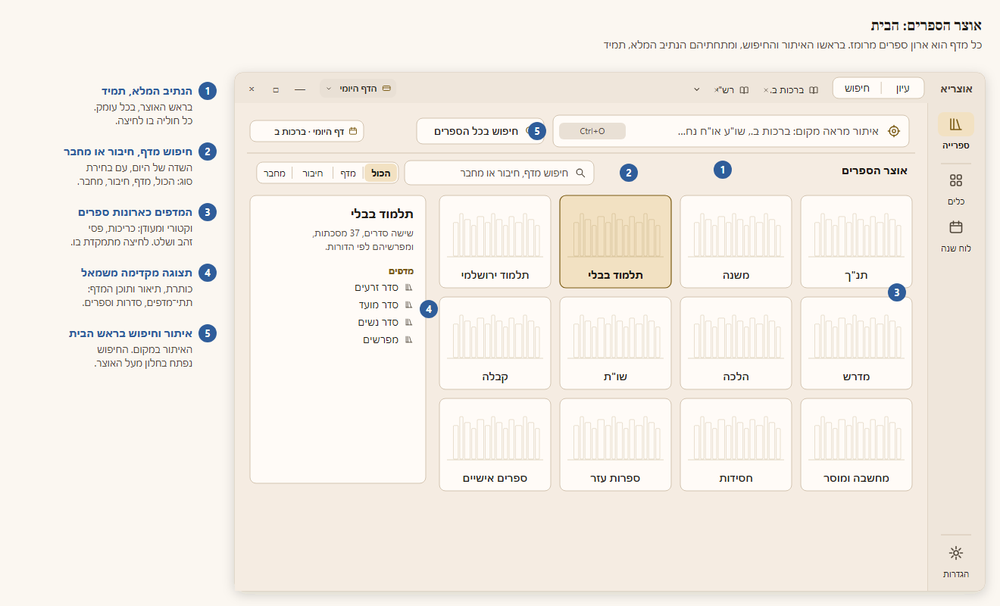

**התמקדות במדף:** בחירת מדף היא התמקדות בו. הארון בא למרכז המסך, והכריכות שבו הן תתי־המדפים או הספרים. השכנים נשארים בצדדים, מעומעמים, כדי שיהיה ברור איפה עומדים. הנתיב בראש מתעדכן, וההקשר הכללי לא אובד.

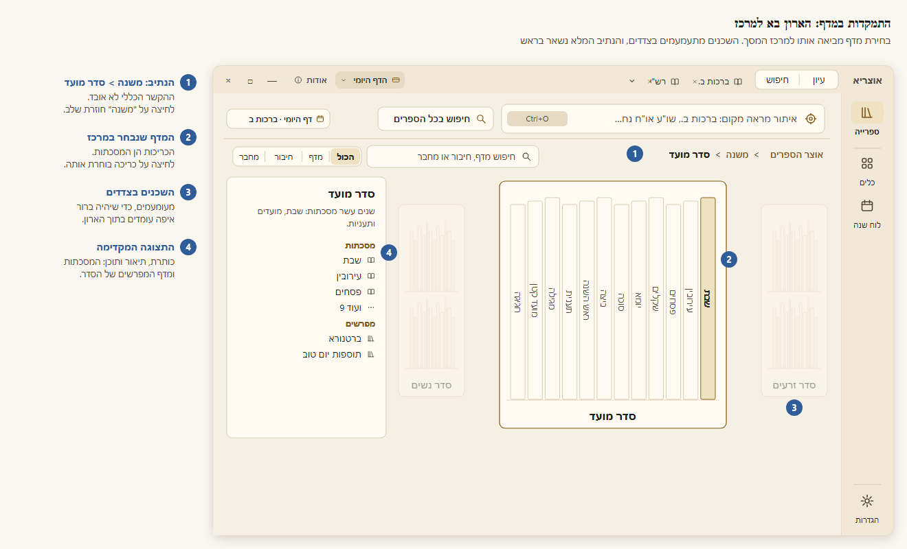

**חיבור ומחבר:**
- כשהמדף, הסדרה או החיבור מיוחדים למחבר מסוים, שם המחבר מופיע בשורה השנייה, מתחת לשם החיבור.
- לחיצה על שם המחבר פותחת כרטיס מידע ובו שנים, מקום, תקופה, רבותיו, תלמידיו ומחיבוריו, וקישורים ל"כל ספרי המחבר" ו"לביוגרפיה המלאה". כל הנתונים האלה כבר קיימים בקוד, ב־`Biography` (`lib/tools/biographies/`).
- **ציר התקופות (הצעה):** כשנבחרים חיבור או מחבר, בצד שמאל של התצוגה המקדימה מופיע ציר תקופות דק: תנאים, אמוראים, גאונים, ראשונים, אחרונים ובדורנו. רואים בו היכן החיבור או המחבר עומד ברצף מסירת התורה. כשיש מידע, רבותיו מופיעים מעליו בציר ותלמידיו אחריו. הציר מעודן מאוד, כסימן מים (כלל 10).

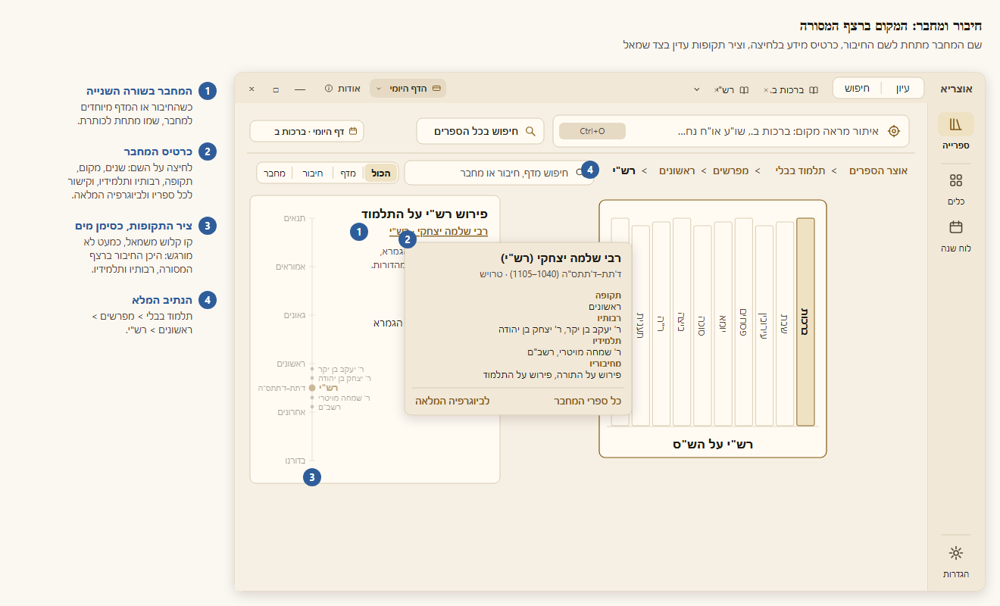

**ארון הספרים כחלונית:** בתוך העיון אפשר לפתוח את האוצר כחלונית צד ימנית, ברשימה. זה כמו להרים את הראש מעל הסטנדר, ולהסתכל מה עוד אפשר להוציא מהארון.
- בראש החלונית יש אותה שורת איתור, ומתחתיה סינון מדפים וספרים.
- ספר שנבחר נפתח בכרטיסייה חדשה בשולחן הנוכחי, והחלונית נשארת פתוחה.
- בתחתית החלונית יש קישור "לאוצר המלא", שעובר למסך הספרייה באותו מקום.

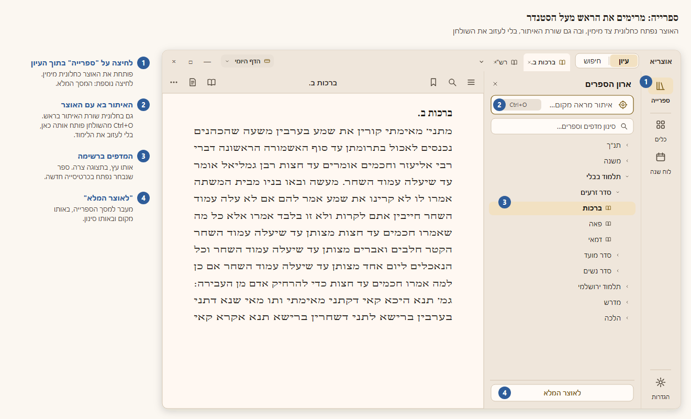

### 5.2 עיון: השולחן

כשלומדים, כל הדעת שם, בדעת שלמה וברוח נדיבה. לא מביטים במדפי הספרייה, לא מתכננים מה לחפש אחר כך ולא מתי לעדכן את אוצר הספרים, ובוודאי לא פוזלים לכלי או להדמיה. לכן שולחן העיון נקי: מה שאינו הלימוד עצמו לא מושך בו את העין.

**מוצע:**
- השולחן נשאר כמו היום: מלוא המסך, כרטיסיות, ורשימה נפתחת של הפתוחים ושל אלה שנסגרו לאחרונה.
- **שולחנות עבודה גלויים:** שם השולחן הנוכחי מופיע בשורת הכותרת. לחיצה עליו פותחת רשימה נפתחת של השולחנות, כמו ערימות של ספרים, במקום חלון נפרד. מנהלים את השולחנות מתוך אותה רשימה.
- המפרשים יוצאים משמאל לספר (כלל 2).

**לא משתנה:** אזור הקריאה, סרגל הקורא, החלון המפוצל ומיקום הכרטיסיות (למעלה או בצד).

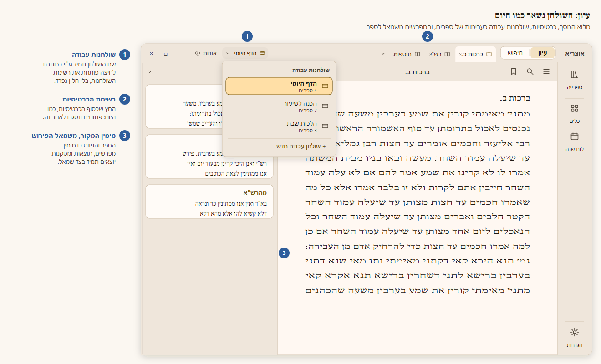

**מפרשים וקישורים: המשך הכרך** (כלל 11). בגמרא יש עשרות עמודים של הגמרא עצמה, עם רש"י ותוספות על הדף, ואחריהם באים עמודי הרי"ף, הרא"ש ושאר המפרשים. כך גם כאן:
- הספר היסודי נשאר פתוח במקום שבו אוחזים בו. השורה מסומנת בעדינות, והדף לא זז.
- המפרשים שאינם על הדף נפתחים בחלונית משמאל, כמו דפדוף להמשך הכרך. אין לחלונית כותרת שמסבירה זאת. רק בגבול השמאלי החיצוני שלה יש קווים דקיקים ובהירים מאוד, כקצה הדפים (כלל היסוד).
- בחלונית הניווט והכותרות מימין יש רמז קלוש לכריכה, בגבול הימני שלה.
- בראש החלונית יש לשוניות קטנות לבחירת המפרש, לפי סדר הכרך.
- קישור נפתח באותה חלונית משמאל, כמו דפדוף למקום אחר, והספר נשאר במקומו.

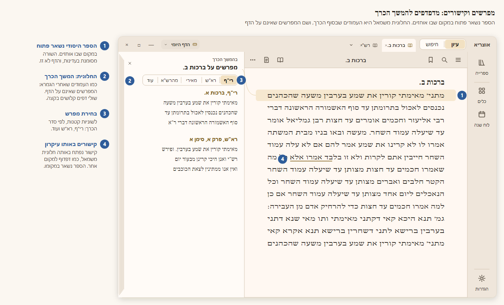

### 5.3 איתור: סימנייה ביד, בתוך האוצר

האיתור הוא בקשה לגשת ישירות למראה מקום ידוע. זו פעולה פשוטה וחד־פעמית, כמו לפתוח סימנייה בספר שמוציאים מן הארון. לכן מקומו בתוך עולם הספרייה, ולא בשורת הכותרת ליד שם התוכנה (כלל 7).

**מוצע:**
- האיתור יוצא מהעמודה. במקומו יש **שורת איתור** בראש מסך האוצר, ושורה כזו גם בראש החלונית "ארון הספרים".
- Ctrl+O, כמו היום, מביא אליה מכל מקום. מהספרייה הוא ממקד את השורה. מהשולחן הוא פותח את ארון הספרים כחלונית, עם השורה בראשה, בלי לעזוב את הלימוד.
- מקלידים מראה מקום, ותוך כדי כך נגללת רשימה ובה שלושה מקטעים: **מראי מקום**, **סימניות** ו**נפתחו לאחרונה**. כולם גישה ישירה למקום ידוע, ולכן כולם במקום אחד.
- Enter פותח את התוצאה הראשונה בשולחן הנוכחי.
- בתחתית הרשימה יש שני מעברים. "חפש בכל הספרים" פותח את חלון החיפוש. "איתור מתקדם…" פותח את החלון של היום, עם כל המסננים שלו.
- **כל שורה יודעת את מקומה:** מתחת לכל מראה מקום מופיע הנתיב המלא שלו בספרייה. כשמסמנים שורה, המדף שהמקום שייך לו מקבל באוצר שמאחור הדגשה מעודנת מאוד, כמעט לא מורגשת: שטיפה חמה וקלושה, כסימן מים (כלל 10). גם התצוגה המקדימה עוברת לאותו מדף.

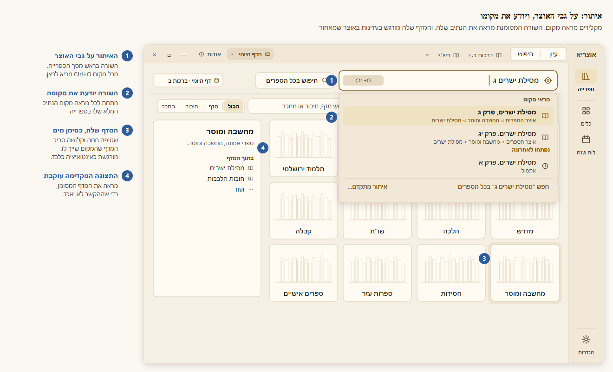

### 5.4 חיפוש: השולחן השני

החיפוש הוא פעולה ארוכה, שצריכה יישוב דעת בפני עצמו:

1. צריך להגדיר את תנאי החיפוש: איפה מחפשים, ואילו מילים בדיוק.
2. פעמים רבות חוזרים ומדייקים את השאילתה.
3. התוצאה שלו היא לא מקום אחד, אלא **רשימה** שרוצים לראות מול העיניים, להתבונן בה ולחקור אותה.
4. מכל אלה, רוצים גם שהרשימה תישמר להמשך.

לכן החיפוש דומה לסטנדר נוסף ליד השולחן.

**חלון החיפוש, מעל הבית** (כלל 8): הכפתור "חיפוש בכל הספרים" שבראש האוצר, או Ctrl+Shift+F, פותח חלון ייעודי שמונח על גבי האוצר. האוצר נשאר מאחור, מובהר: לא מסיח את הדעת, אבל גם לא נעלם מן ההקשר. בחלון מגדירים את השאילתה ואת התנאים: איפה מחפשים, באיזה אופן, באיזו תקופה ובאיזה מרחק בין המילים. שם מופיעים גם החיפושים האחרונים. לחיצה על "חיפוש" מניחה את רשימת התוצאות בשולחן החיפוש.

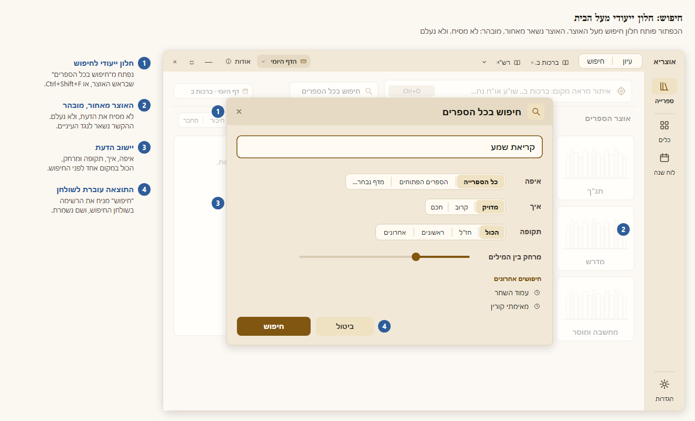

**מוצע:**
- **מתג "עיון | חיפוש" בראש החלון**, בשורת הכותרת, מימין, ליד שם התוכנה. הוא מחליף את כל השולחן: את הכרטיסיות ואת התוכן (כלל 3).
- לכל שולחן יש רשימת כרטיסיות משלו. כרטיסיות החיפוש יושבות רק בשולחן החיפוש, והספרים נשארים בשולחן העיון. כל שולחן זוכר את הכרטיסייה האחרונה שהייתה פתוחה בו.
- חיפוש חדש נפתח בכפתור "+" בשולחן החיפוש, או ב־Ctrl+Shift+F, כמו היום.
- **שמירת רשימה:** הרשימה נשמרת עם השאילתה והסינון, כדי לחזור אליה אחר כך.
- **במקביל ללימוד:** ממשיכים להשתמש ברשימה תוך כדי הלימוד, ופותחים דרכה חלונות נוספים. לכן היא זמינה בקלות, ואפשר לעבור אליה ולחזור לשולחן הלימוד בלחיצה.
- **הבדל קל בין השולחנות:** לשולחן החיפוש גוון רקע מעט שונה מזה של העיון, טיפה בהיר או כהה יותר. זה מספיק כדי שהתת־מודע ירגיש את ההבדל, כמו שאפשר בבר אילן, והוא כסימן מים (כלל 10).
- **ספר המפתחות ליד הגמרא:** "פתח לצד הספר" מניח את רשימת התוצאות משמאל לספר, בחלון מפוצל בשולחן העיון. אפשר לעשות זאת היום בגרירה, וההצעה רק מקצרת את הדרך.
- בתוך שולחן החיפוש, עץ הסינון לפי ספרים יושב מימין והתוצאות משמאל (כלל 2).

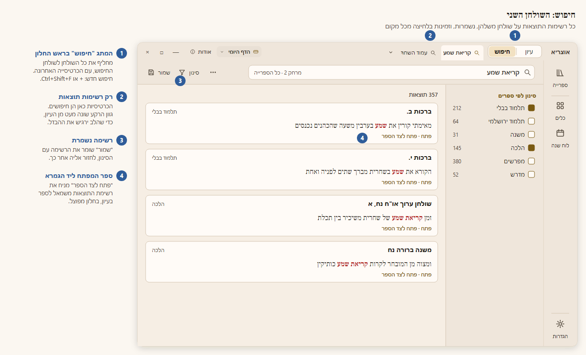

**אפשרות: שני השולחנות זה מאחורי זה.** כמו חלונות של Windows: שולחן החיפוש מונח מאחורי שולחן העיון, וקצהו מציץ. נגיעה בקצה מקדימה אותו. זה לצד זה אין מקום, ואם הם מוסתרים לגמרי, המעבר מבלבל. כשהם חופפים בחלקם, עוברים מזה לזה בקלות. ייתכן שיש מי שזה יבלבל דווקא, ולכן זו אפשרות לבחירה. המתג בראש החלון נשאר בכל מקרה. ההכרעה בידי המפתחים (§7).

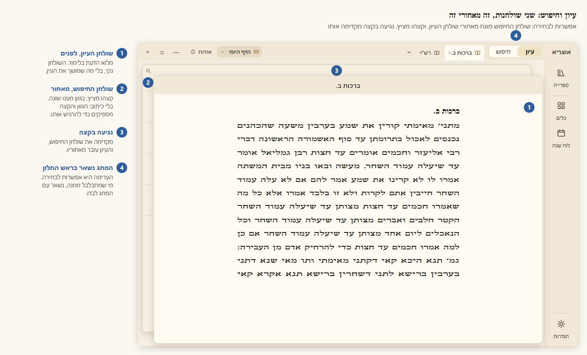

### 5.5 כלים: ארון בעל דלתות ותאים

הכלים הם הארון בעל הדלתות והתאים, או תיבה נייחת או תיק נייד, שבו שומרים את כלי העבודה: היומנים, הסרגלים והמרקרים, האלבומים, המפות והאנציקלופדיות. אולי גם את הטלפון לחבר המומחה, שיוכל להשיג מידע או עזרה. יש שידמו אותו לארון הסגור, ואף הנעול, שבו המחשב המחובר לרשת. אבל זה נאמר על התוספים המקוונים בלבד. רוב התוספים אינם מקוונים, והם חלק חשוב מן הארון.

**מוצע:**
- "כלים" נשאר בעמודה, מתחת לקו שמפריד אותו מהספרייה. הכלים והתוספים המוצמדים יושבים אחריו, בחלק משלהם.
- **הארון:** לחיצה על "כלים" פותחת ארון מעל המקום שבו עומדים, והמקום נשאר מאחור, מובהר (כלל 8).
- **מימין, הכלים המובנים:** תא לכל סוג: כלי עבודה, יומנים, מידות וחשבונות, מילונים, קריאה בתורה וניהול הכלים.
- **משמאל, התוספים:** הטור האנכי השמאלי כולו מוקדש לתוספים. הם מקבלים מקום חשוב בארון, ומחולקים לפי סוגיהם וייעודיהם, באותה חלוקה שבחנות התוספים: כלי לימוד, קריאה משופרת, איורי עזר ללימוד, כלי קודש, היסטוריה יהודית, תפילה ועזרים. בראש הטור יש קישור לחנות, שבה אותה חלוקה בדיוק.
- **איפה נפתח כלי:** היום כלי נפתח ככרטיסייה בשולחן העיון. לפי עקרון השולחן הנקי, כדאי שכלי שאינו משרת את הקריאה עצמה ייפתח במקום משלו. כלי שמשרת את הקריאה, כמו מרקר, הערות או מילון, ייפתח בחלונית משמאל לספר. ההכרעה בידי המפתחים (§7).
- כשהעמודה מתמלאת בכלים מוצמדים, הם נכנסים לגלילה בתוך החלק שלהם. הם לא דוחפים את ההגדרות ולא מזיזים אותן ממקומן.

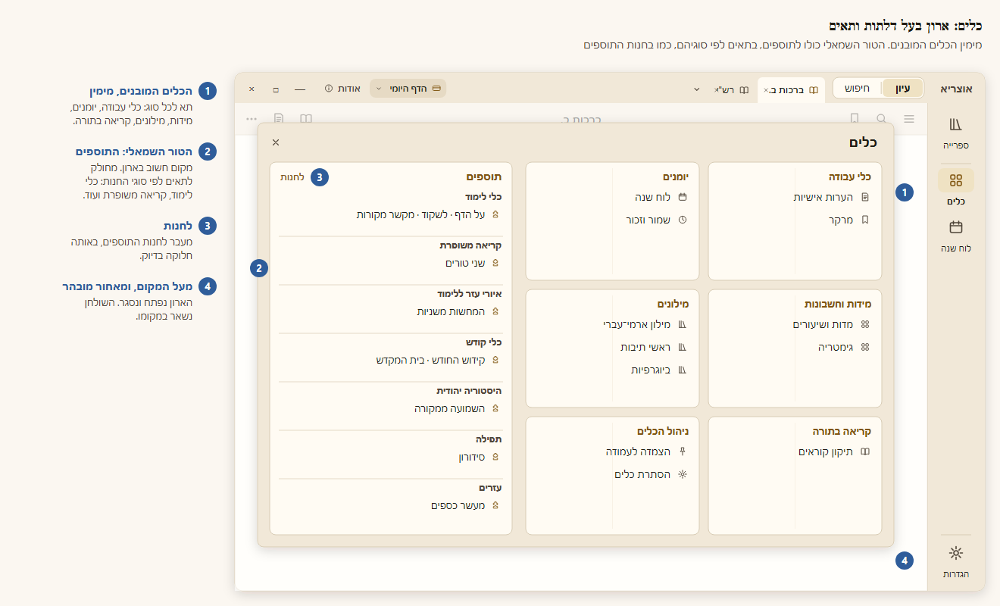

### 5.6 הגדרות: ארון השירות

ההגדרות הן עניין טכני ושולי, שמחוץ לשטח העבודה. גם היום הסמל שלהן מופרד מהשאר ועומד בתחתית. אבל הן נפתחות כמסך מלא, כמו מקום שבאים לשהות בו. זה ארון שירות, ובו השעון, לוח החשמל והמונה, ועוד הרבה עניינים שלא מצאו להם מקום והוחבאו שם. זה צריך סידור רציני ושידוד מערכות מן היסוד.

**מוצע:**
- **חלון צף**, `AppDialogFrame(size: large)`, שנפתח מעל השולחן. מתחת לרוחב 600 הוא נפתח במסך מלא, לפי DD-16. Esc סוגר אותו, והלימוד נשאר מאחוריו במקומו.
- בתוך החלון יש עמודת ניווט מימין, וחיפוש בהגדרות כמו היום.
- המבנה הפנימי לפי ההצעה למבנה ההגדרות: שמונה לשוניות בשלוש קבוצות.
  - **תצוגה וקריאה:** מראה, כתב, עיון בספר.
  - **ספרייה וכלים:** ספרייה, חיפוש, כלים.
  - **התוכנה:** קיצורי מקשים, מערכת.
- **אודות ותודות יוצאים מן ההגדרות לגמרי.** היום הוחבאו שם מגילת היסוד "אודות" אוצריא, שמסבירה מה היא, מה יש בה ואיך משתמשים בה, ורשימת התודות. הם ראויים למקום מרכזי הרבה יותר: כפתור "אודות" בשמאל שורת הכותרת העליונה.

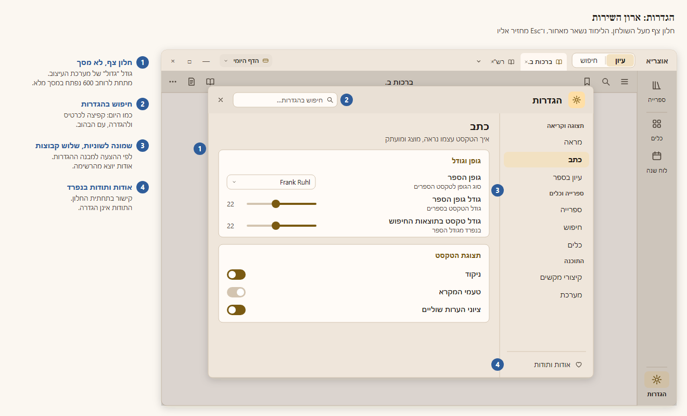

### 5.7 מסכים צרים

- **בטלפון:** סרגל תחתון ובו ספרייה, עיון, חיפוש וכלים. בסרגל התחתון אין שורת כותרת שאפשר לשים בה את המתג, ולכן עיון וחיפוש חוזרים להיות יעדים בו. ההגדרות נמצאות בתפריט "עוד".
- **שורת האיתור:** בראש מסך הספרייה, כמו במחשב.
- **הגדרות:** חלון במסך מלא (DD-16).
- **ארון הספרים:** בטלפון אין חלונית צד. הוא נפתח כגיליון שעולה מלמטה, ושורת האיתור בראשו.

### 5.8 צבעים: "דבש וחלב"

ערכת ברירת המחדל "חום זהב" צריכה להיות בגווני שמנת, חול, בז' וזהב בלבד, בלי ורוד ובלי כתום. היום השטחים נוטים לוורוד, והבחירה נראית כתומה־ורודה (אפרסק). ההצעה משנה רק את הסולם של הערכה הזו ב־`AppThemeData.createColorScheme`, כמו שכבר נעשה בערכות "לבן" ו"פרגמנט" (DESIGN_SYSTEM §2.1.4). קוד פיצ'ר לא משתנה.

| תפקיד | היום (נדגם מצילומי המסך במאגר) | מוצע |
|---|---|---|
| רקע קריאה (`surface`) | `#FFF8F4`, נוטה לוורוד | `#FFFBF3`, חלב־שמנת |
| רקע לוח | `#F4E8DD` | `#F6EFE3`, חול בהיר |
| סרגל, עמודה וחלונית ניווט (`surfaceContainerHigh`) | `#F3E6DA` | `#F1E8D8`, חול |
| שדה וכותרת דיאלוג (`surfaceContainerHighest`) | `#E5D5C2` | `#E6DAC4`, בז' |
| בחירה (`secondaryContainer`, `primaryContainer`) | `#FBDEBC`, אפרסק | `#EFE2C3`, שמנת־זהב |
| קו (`outlineVariant`) | `#D3C4B4` | `#D8CCB5`, בז' |
| הדגשה (`primary`) | `#805610`, חום זהב | ללא שינוי |

**גופנים בהדמיות:** כמו באוצריא. טקסט הספר ב־FrankRuhlCLM, גופן ברירת המחדל של הספרים. המפרשים ב־NotoRashiHebrew, כתב רש"י. הממשק בגופן המערכת (Segoe UI), לפי DD-01.

## 6. תכנית מימוש

כל שלב הוא PR אחד, ממוקד, ועם תמונות לפני ואחרי, כפי ש־DESIGN_SYSTEM §0 דורש לכל שינוי מראה. לפי DD-30 B, פירוק של קובץ גדול נעשה כ־commit נפרד שמשמר את ההתנהגות, לפני ה־commit שמשנה את המראה. כל שלב עומד בפני עצמו: אפשר לעצור אחרי כל אחד מהם, והתוכנה נשארת שלמה.

| שלב | מה | קבצים עיקריים | סיכון | תלוי ב |
|---|---|---|---|---|
| 0 | המסמך הזה וההדמיות | `docs/design-system/` | אין | — |
| 1 | **הגדרות כחלון צף.** `SettingsScreen` נפתח ב־`showDialogUntilTornDown` בתוך `AppDialogFrame(size: large)`. העמוד השלישי יוצא מה־`PageView` הראשי. `Screen.settings` נשאר כמצב "החלון פתוח", כמו `find` היום | `main_window_screen.dart`, `settings_screen.dart`, `navigation_bloc.dart` | בינוני: קישורים עמוקים להגדרות, יעדי הסיור המודרך (`TourTargetKeys.settingsTabs`), `SettingsScreenController.openTab` | 0 |
| 2 | **סידור ההגדרות מבפנים**, לפי ההצעה למבנה ההגדרות. כרטיסים עוברים בין לשוניות, ו"אודות" יוצא לקישור | `lib/settings/tabs/*`, `settings_screen.dart`, אינדקס החיפוש | נמוך: העברת כרטיסים, `searchEntries` מתעדכנים | 1 |
| 3 | **שני שולחנות.** מתג "עיון \| חיפוש" בשורת הכותרת. הכרטיסיות מסוננות לפי השולחן, וכל שולחן זוכר את הכרטיסייה הפעילה שלו. עיון וחיפוש יוצאים מהעמודה, וכפתור "+" לחיפוש חדש | `custom_title_bar.dart`, `reading_screen.dart`, `navigation_bloc.dart`, ה־bloc של הכרטיסיות, `tab_search_menu.dart` | גבוה: שמירת כרטיסיות ושולחנות עבודה, חלון מפוצל שמשלב ספר ותוצאה (שייך לעיון), קיצורי מעבר בין כרטיסיות | 0 |
| 4 | **שורת האיתור בראש האוצר**, עם מקטעים למראי מקום, לסימניות ולאחרונים. `FindRefDialog` נשאר כ"איתור מתקדם". איתור יוצא מהעמודה, וכפתורי הסימניות וההיסטוריה יוצאים מהכותרת. Ctrl+O מביא לשורה. כל שורה מציגה את הנתיב שלה, והמדף שלה מודגש כסימן מים | `library_browser.dart` (פירוק לפני כן), `lib/find_ref/`, `lib/bookmarks/`, `lib/history/`, `custom_title_bar.dart` | בינוני: פוקוס ומקלדת, ושתי שורות קלט סמוכות במסך הספרייה | 0 |
| 5 | **ארון הספרים כחלונית ימנית** בעיון, עם שורת האיתור בראשה. תצוגת רשימה של הספרייה בתוך `AdaptiveSidePane` בצד ההתחלה. Ctrl+O מהשולחן פותח אותה | `library_browser.dart`, `reading_screen.dart` | בינוני: `library_browser.dart` גדול, ומופיע ב־§4.3 בין הקבצים שמחכים לפירוק | 4 |
| 6 | **שם שולחן העבודה בכותרת**, עם רשימה נפתחת. `WorkspaceSwitcherDialog` נשאר לניהול מלא | `custom_title_bar.dart`, `lib/workspaces/view/` | נמוך | 3 |
| 7 | **אוצר הספרים:** המדפים כארונות ספרים, הנתיב המלא בראש, התמקדות במדף שמביאה אותו למרכז, וחיפוש לפי מדף, חיבור או מחבר. התווית של השדה מתחלפת | `library_browser.dart`, `grid_items.dart`, `library_breadcrumb_bar.dart`, `category_preview_panel.dart` | בינוני: סימן המים של הארון צריך רכיב משותף קל, בקו בלבד ונגזר מערכת הנושא, ובדיקה בבהיר, בכהה וב"לבן" | 4 |
| 8 | **חיבור ומחבר בתצוגה המקדימה:** שם המחבר בשורה השנייה, כרטיס מחבר בלחיצה, וציר התקופות כסימן מים | `category_preview_panel.dart`, `book_preview_panel.dart`, `lib/tools/biographies/` | נמוך עד בינוני: הנתונים קיימים ב־`Biography` (תקופה, שנים, רבותיו, תלמידיו). הציר מוצג רק כשיש מידע | 7 |
| 9 | **חלון החיפוש מעל האוצר**, עם רקע מובהר. `SearchDialog` של היום נפתח מעל האוצר, והתוצאות עוברות לשולחן החיפוש | `search_dialog.dart`, `main_window_screen.dart`, `AppSurfaces.scrim` | נמוך: צריך גוון מובהר ל־scrim, ולא כהה, כטוקן חדש ב־`AppSurfaceColors` | 3 |
| 10 | **מפרשים וקישורים כהמשך הכרך:** חלונית משמאל עם לשוניות מפרשים, שולי דפים קלושים, והשורה שבספר מסומנת בעדינות. קישור נפתח באותה חלונית | `lib/widgets/commentary/`, `link_preview_overlay`, `reading_screen.dart` | בינוני: `lib/widgets/commentary/**` נמצא ב־§4.3 בין הרכיבים שמייבאים פיצ'רים | 0 |
| 11 | **"אודות" בשורת הכותרת:** כפתור בשמאל שורת הכותרת, שפותח את מגילת היסוד ואת התודות. הלשונית "אודות" יוצאת מן ההגדרות | `custom_title_bar.dart`, `lib/settings/tabs/about_settings_tab.dart` | נמוך | 1 |
| 12 | **ארון הכלים:** `ToolsLauncherPanel` הופך לארון שנפתח מעל המקום עם רקע מובהר. מימין תאים לכלים המובנים, ומשמאל טור לתוספים לפי קטגוריות החנות | `lib/tools/view/tools_launcher_panel.dart`, `lib/plugins/` | בינוני: צריך את הקטגוריה של כל תוסף מותקן, כמו שהחנות מסווגת אותו | 9 |
| 13 | **גוון שולחן החיפוש, ושולחנות זה מאחורי זה** (אפשרות לבחירה) | `reading_screen.dart`, `AppSurfaceColors` | בינוני: הערימה צריכה החלטה ובדיקת שימושיות | 3 |
| 14 | **"דבש וחלב":** סולם המשטחים וגוון הבחירה של ערכת "חום זהב" בבהיר | `lib/theme/app_theme_data.dart` | נמוך: מקום אחד, עם תמונות לפני ואחרי. לבדוק ניגודיות | 0 |
| 15 | **מסכים צרים:** הסרגל התחתון, שורת האיתור והגיליון של ארון הספרים | `main_window_screen.dart`, `bottom_nav_labels.dart` | בינוני | 3, 4, 5 |

**סדר מומלץ:** 0, 14, 1, 11, 2, ואז האוצר: 4, 7, 8 ו־5, ואז השולחנות: 3, 9, 13 ו־6. שלבים 10 ו־12 יכולים לרוץ במקביל, ובסוף שלב 15. שלבים 1 ו־2 נותנים שיפור גלוי כבר בהתחלה, בסיכון נמוך.

## 7. שאלות להכרעה

1. **האם עיון וחיפוש יוצאים מהעמודה?** המלצה: כן, כי המתג בראש החלון כבר עושה את עבודתם. כפילות תבלבל. בטלפון הם נשארים בסרגל התחתון (§5.7).
2. **שולחנות עבודה ושולחן החיפוש:** האם שולחן עבודה שומר גם את רשימות החיפוש שלו? המלצה: כן. שולחן עבודה הוא "סוגיה", והחיפושים שלה שייכים לה.
3. **סימניות והיסטוריה:** האם הכפתורים יוצאים מהכותרת, לטובת הרשימה של שורת האיתור באוצר? המלצה: כן. הניהול המלא נשאר בחלונות הקיימים, ופותחים אותם מתוך הרשימה.
4. **איך פותחים את ארון הספרים כחלונית?** אפשר בלחיצה שנייה על "ספרייה" כשכבר נמצאים בעיון, או בכפתור בסרגל הקורא. המלצה: שתי הדרכים.
5. **Ctrl+O מתוך השולחן:** האם הוא פותח את ארון הספרים כחלונית ליד הלימוד, או עובר למסך האוצר? המלצה: חלונית, כדי שהלימוד יישאר מול העיניים.
6. **ציר התקופות:** האם להציגו רק כשיש לחיבור או למחבר תקופה ושנים בביוגרפיות? המלצה: כן. בלי מידע אין ציר, ואין לנחש.
7. **רקע מובהר:** האם החלונות הצפים שמעל הבית (חיפוש, הגדרות) יקבלו רקע מובהר במקום ההחשכה של היום? המלצה: כן, כטוקן נפרד, כדי שההקשר יישאר גלוי.
8. **שני השולחנות זה מאחורי זה:** מתג בלבד, גוון רקע שונה, או גם ערימה חופפת לבחירה? המלצה: מתג וגוון תמיד, וערימה כאפשרות בהגדרות. ההכרעה בידיכם.
9. **איפה נפתח כלי:** ככרטיסייה בשולחן העיון כמו היום, במקום משלו, או בחלונית משמאל לספר? המלצה: כלי שמשרת את הקריאה בחלונית משמאל, וכל השאר במקום משלו, כדי שהשולחן יישאר נקי.
10. **"דבש וחלב":** האם לשנות את סולם הצבעים של ערכת ברירת המחדל לשמנת, חול, בז' וזהב, ואת הבחירה לשמנת במקום אפרסק (§5.8)? המלצה: כן. זה שינוי במקום אחד, ב־`AppThemeData`, עם תמונות לפני ואחרי לאישור.
11. **מיקום הכרטיסיות "בצד":** בעמודת הכרטיסיות הצדדית, המתג בין השולחנות נשאר בכותרת. ראש עמודת הכרטיסיות מראה את שם השולחן ואת מספר הכרטיסיות שבו.
