# מבנה התוכנה: המתווה המפושט

> **מעמד:** הצעה לדיון. מחליפה בפועל את המתווה הרחב שב־[APP_STRUCTURE.md](APP_STRUCTURE.md); זה נשאר לעיון ולא נמחק.
> **מקור:** [פוסט 50637](https://otzaria.org/forum/post/50637) בפורום, והדיון שקדם לו.
> **ההדמיות:** בערכת "חום זהב" בגווני "דבש וחלב" (APP_STRUCTURE §5.8). טקסט הספרים בפרנקריהל, הכותרות בדרוגלין (כבתוספים), הממשק בגופן המערכת. שמות הספרים והמדפים, מניין הספרים במדף ותוכני העניינים — מן המסד של אוצריא. המספרים בתוצאות החיפוש להמחשה בלבד.
> **ההגדרות אינן חלק מן המתווה הזה.** הן נושא בפני עצמו.

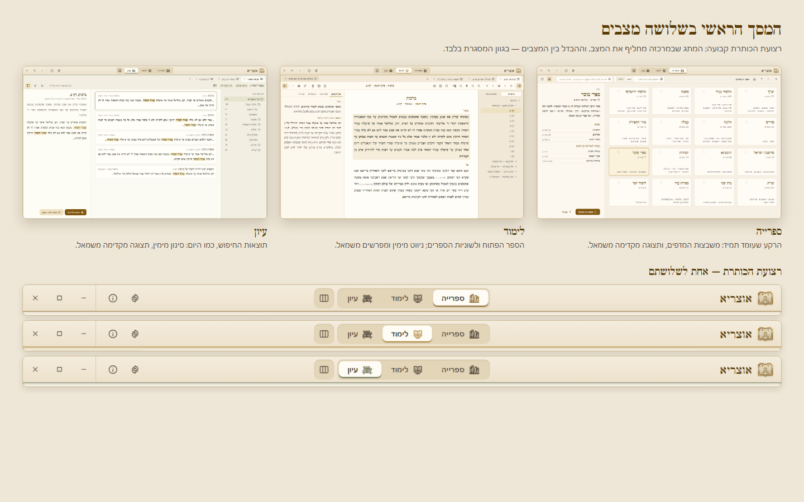

## 1. שלושה מצבים למסך הראשי: סל"ע

| המצב | מה בו |
| ---: | ---: |
| **ספרייה** | הרקע שעומד תמיד: משבצות המדפים, ותצוגה מקדימה משמאל |
| **לימוד** | הספר הפתוח ולשוניות הספרים. ניווט מימין, מפרשים משמאל. מעבר בין שולחנות עבודה |
| **עיון** | תוצאות החיפוש, כמו היום. סינון מימין, תצוגה מקדימה משמאל. לשונית לכל חיפוש |

**ס**פרייה · **ל**ימוד · **ע**יון — סל"ע.

ההבדל בין המצבים בגוון המסגרת בלבד: עץ לספרייה, זהב ללימוד, דיו זית לעיון. כל השאר — אותה תוכנה.

**שים לב:** מה שנקרא עד היום "עיון" (הספר הפתוח) נקרא כאן **לימוד**. **עיון** הוא מסך תוצאות החיפוש.

## 2. פרישה: שניים או שלושה במקביל

במסך רחב אפשר לפרוש את המצבים זה לצד זה, כל אחד בצורה מצומצמת. בראש כל חלונית — הסמל שלה.

- **ספרייה** — חלונית ימנית צרה, בתצוגת רשימה.
- **לימוד** — במרכז, בלי חלונית הניווט.
- **עיון** — טור שמאלי של תוצאות. בחירת תוצאה פותחת אותה בלימוד שלצדה.

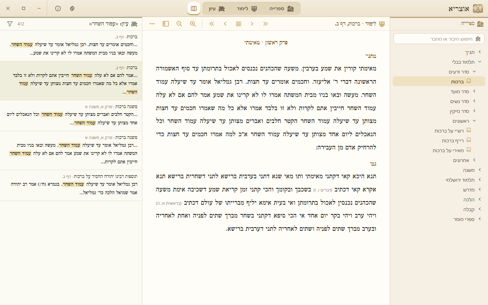

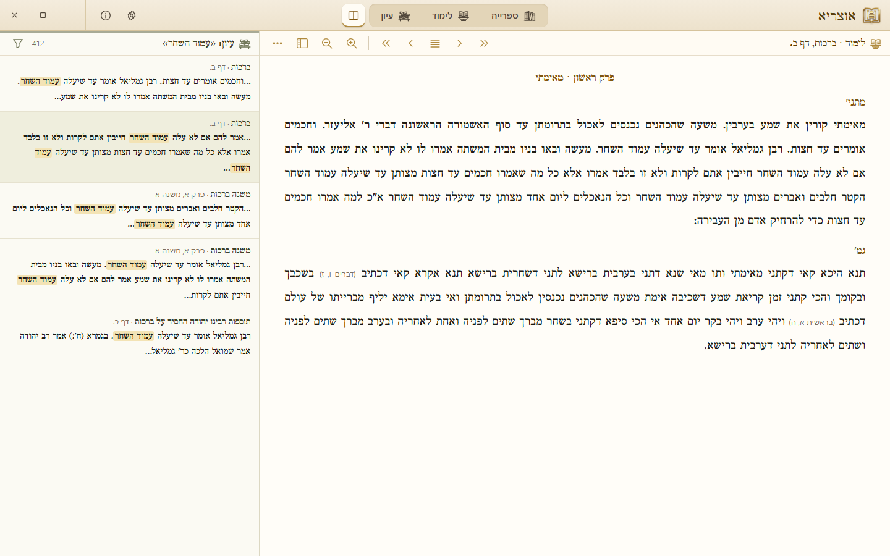

## 3. רצועת הכותרת הקבועה

רצועה אחת בראש החלון, זהה בשלושת המצבים:

- **מימין:** הלוגו המוזהב ושם התוכנה.
- **באמצע:** המתג לשלושת המצבים — ספרייה · לימוד · עיון, כל אחד עם הסמל שלו — ולידו לחצן הפרישה.
- **משמאל:** הגדרות ואודות, ואחריהם כפתורי החלון.

כל מה שמשתנה בין המצבים יושב מתחת לרצועה.

## 4. מסך הספרייה

**עיקרו משבצות המדפים.** בכל משבצת: שם המדף, מספר הספרים, ומדפי המשנה שבו.

**שורה שנייה, של כלי הספרייה בלבד:**

- חזרה, מעלה ובית, והנתיב המלא (אוצר הספרים > ספרי מוסר > אחרונים).
- חיפוש חיבור או מחבר, עם בורר: **חיבור | מחבר**.
- איתור ישיר לפי מראה מקום ("ברכות ב." · "או״ח רלה א").
- משבצות או רשימה.

**חלונית התצוגה המקדימה משמאל** מתחלפת לפי הבחירה:

- **מדף:** תיאור המדף ותוכנו.
- **ספר:** שם הספר והמחבר, התיאור הקצר והארוך, ותוכן הספר. לחצנים: פתח ללימוד · על המחבר · מקור.
- **מחבר (בחיפוש לפי מחבר):** פרטי המחבר, ובשולי החלונית משמאל, בקו עדין, מקומו על ציר מסירת התורה.

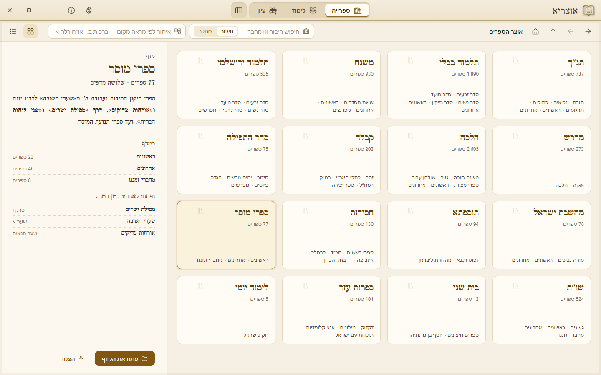

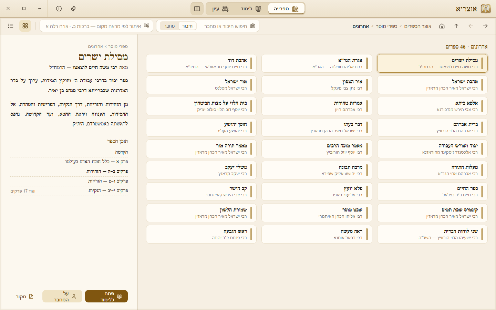

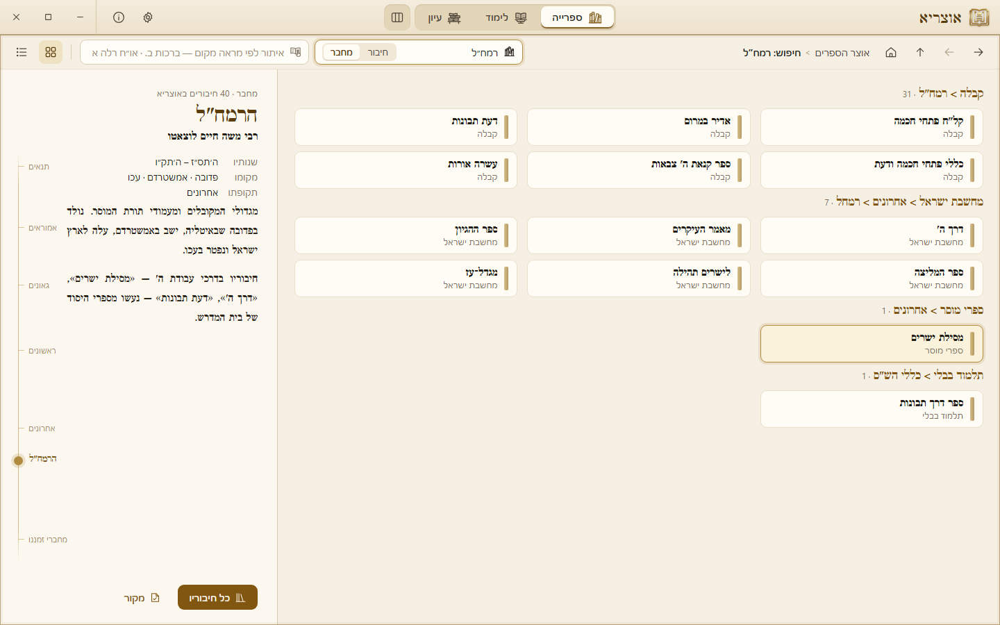

## 5. מסך הלימוד

כל כפתורי התפעול של היום נשארים, ומסודרים בשורה אחת:

- **מימין:** פתיחת חלונית הניווט.
- **אחריו:** הדף הקודם · הקטע הקודם · שורות או רציף · הקטע הבא · הדף הבא.
- **אחריהם:** הגדלה והקטנה, ניקוד וטעמים, חיפוש בספר, איתור, סימנייה, הערות אישיות, נוסחאות.
- **באמצע:** שם הספר והמקום.
- **משמאל:** אייקוני התוספים שהמשתמש בחר להציג (מסומנים בנקודה זהובה), קישור, הדפסה, עוד — ובקצה **פתיחת חלונית המפרשים**, כנגד חלונית הניווט שמימין.

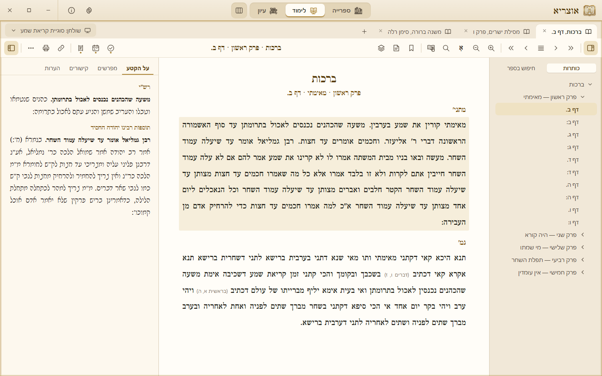

## 6. חלונות הביצוע: איתור וחיפוש

שני חלונות צפים, מעל המסך הראשי. הרקע מאחוריהם מועם.

- **איתור** — ספר ומקום. כל תוצאה עם הנתיב שלה, והמדף שלה מודגש בספרייה שמאחור. הבחירה פותחת את הספר בלימוד.
- **חיפוש** — בכל הספרייה או במדפים ובספרים נבחרים. הבחירה פותחת לשונית חדשה בעיון.

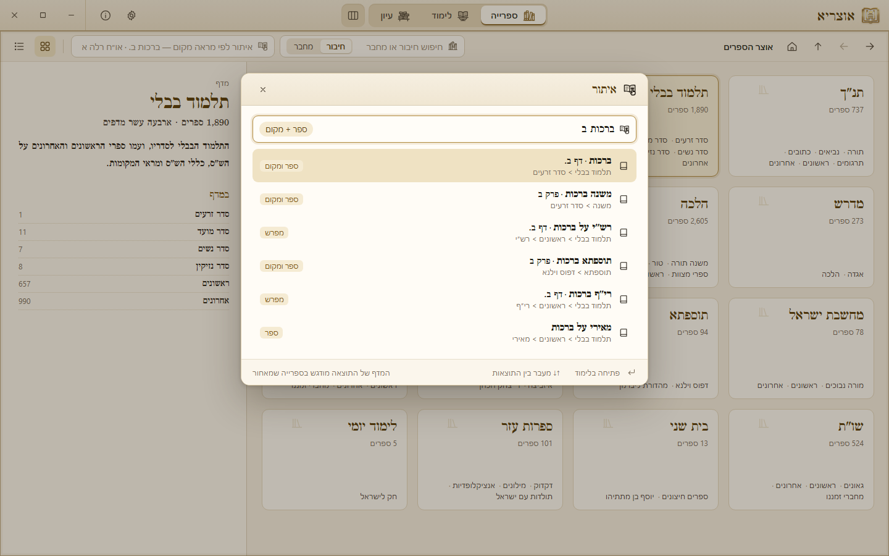

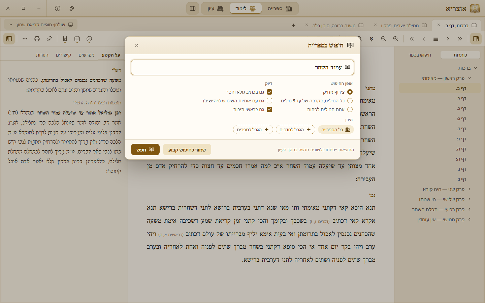

## 7. מסך העיון

כך נראות תוצאות החיפוש אחרי שנמצא המבוקש:

- **שורה עליונה:** מה חיפשו ואיך, מספר התוצאות, מיון וסינון.
- **מימין:** סינון לפי מדף, עם מניין התוצאות בכל מדף.
- **באמצע:** התוצאות, כל אחת עם שם הספר, המקום והנתיב, ומילות החיפוש מודגשות.
- **משמאל:** הקטע בהקשרו. "פתח ללימוד", או "פתח לצד העיון" — לפרישה של שניים.

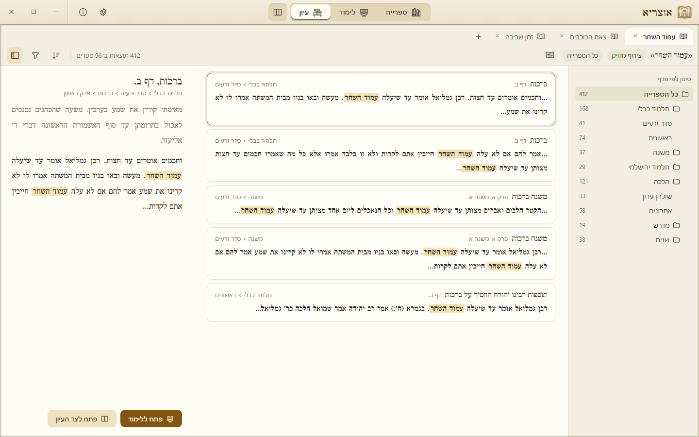

## 8. סדרת האייקונים

קו נקי ומעודן, ברוח הספר הפתוח שבסמל אוצריא.

| הסמל | הציור |
| ---: | ---: |
| **ספרייה** | מדף, ועליו ספרים עומדים |
| **לימוד** | ספר פתוח על סטנדר |
| **עיון** | שלושה ספרים פתוחים זה על זה, על שולחן |
| **חיפוש חיבור או מחבר** (בספרייה) | ספר נשלף מבין ספרי המדף |
| **איתור** | יד מצביעה על שורה בספר פתוח |
| **חיפוש** | ספר פתוח, שורות בהירות, ומילים מסומנות |

שלושת הראשונים — במתג שבראש החלון, ובראש כל חלונית בפרישה.

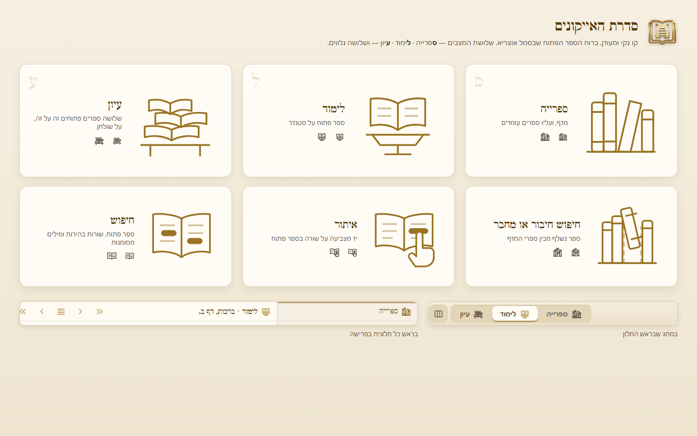

## מה לא נכלל

- **ההגדרות** — בנפרד, בעתו.
- **הכלים** — "מסך אחר", מחוץ ללימוד עצמו (50637). אינו בהדמיות האלה.
- **מסך צר** — ההדמיות ברוחב מחשב. מסך צר לא נבחן כאן.
